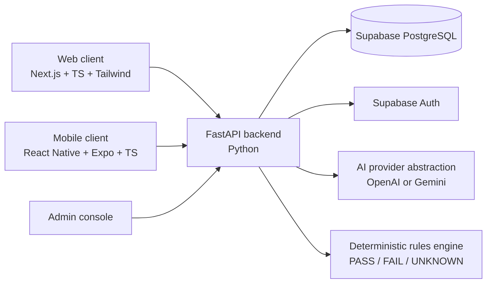

# YOGYA — Proposed Architecture

Status: proposed. Section references are to the PRD (`YOGYA_Complete_PRD.docx`). Items not stated in the PRD are marked TBD.

## 1. Component overview

## 2. Layers
- **Clients:** web (Next.js) and mobile (Expo) call the FastAPI backend. Architecture per PRD 13.
- **Backend:** Python FastAPI service exposing the API (API specification: PRD 15).
- **Data:** PostgreSQL on Supabase. Data model: 14 tables (PRD 14). Exact column types: TBD.
- **Auth:** Supabase Auth, two authenticated roles, Student and Admin (PRD 5).

## 3. AI provider abstraction
- Provider behind an abstraction layer that supports OpenAI or Gemini. Provider choice: TBD.
- AI is limited to profile extraction, follow-up questions, and explanations (PRD 10).
- AI never sets eligibility, requirements, benefits, or deadlines.
- Explanation latency target: under 8 s when the provider is available (PRD 17).

## 4. Deterministic rules engine
- Evaluates verified scheme rules against the student profile.
- Each rule returns PASS, FAIL, or UNKNOWN. Missing data yields UNKNOWN.
- Rule evaluation target: under 500 ms (PRD 17).
- Rule evaluation logic and rule schema: see PRD 10 and PRD 14.

## 5. Admin ingestion, verification, and publication
- Admin ingests scheme information, verifies sources, and publishes schemes (PRD 7, 8).
- Every published scheme references official government information and its verification date (PRD 8).
- Verification follows the Ten-Layer Validation Framework: see PRD 9.
- Ingestion workflow details and OCR scope: TBD.

## 6. Access model
- **Guest:** discovery of published schemes without sign-in.
- **Student:** authenticated; profile, eligibility checks, saved schemes, applications, and reminders (PRD 5, 6).
- **Admin:** authenticated; ingestion, verification, and publication (PRD 5, 7).
- Guest is not a third role.

## 7. Catalogue performance
- Catalogue p95 under 2 s (PRD 17).

## 8. Data protection
- Aadhaar and other sensitive ID numbers are not collected (PRD 16).
- Application tracking is self-reported unless an authorised government integration exists.
- Students apply through official government portals.

## 9. Ten-Layer Validation Framework
See PRD 9 for the layers. Layer names are not restated here.

## 10. TBD items
- Hosting and deployment target: TBD.
- Notification channels for reminders: TBD.
- AI provider choice (OpenAI or Gemini): TBD.
- OCR scope: TBD.
- Exact schema types: TBD (table list is in PRD 14).
- Auth details beyond Supabase Auth: TBD.

## Step 2 additions

### Entity relationships
- users -> role_assignments, student_profiles, scheme_versions
- schemes -> scheme_versions -> scheme_rules, scheme_verification_history
- scheme_sources -> source_documents, scheme_rules
- student_profiles -> saved_schemes, eligibility_checks, applications
- applications -> document_tasks, reminders
- ingestion_jobs (admin ingestion tracking)
- audit_logs (append-only)

### Auth architecture
- Supabase Auth issues the JWT.
- `app_metadata.role` carries `student` or `admin`.
- Guest = no token (discovery only).
- Backend JWT verification is NOT yet implemented (services/api/app/auth.py).

### Data flow
- Ingestion -> review -> verification -> publication.
- Only a published scheme version is eligible for matching.

### Security assumptions
- Service-role key is used server-side only; never shipped to clients.
- RLS is deny-by-default on all tables.
- No Aadhaar, bank, or certificate data is stored.
- Audit log is append-only (enforced by trigger).

### Retention
- Retention periods: TBD.

